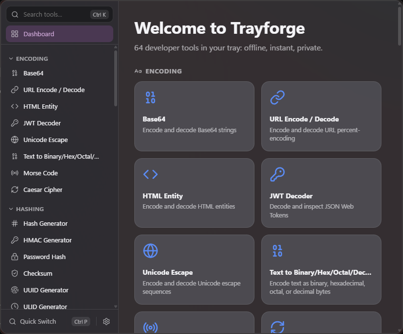
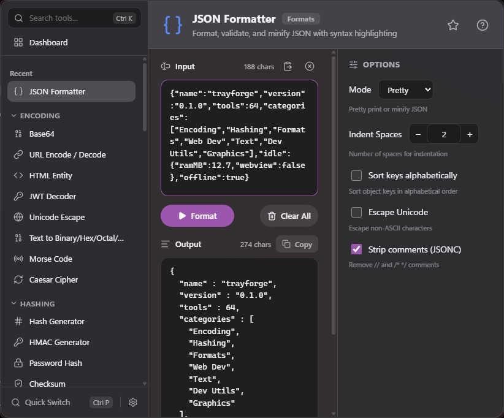
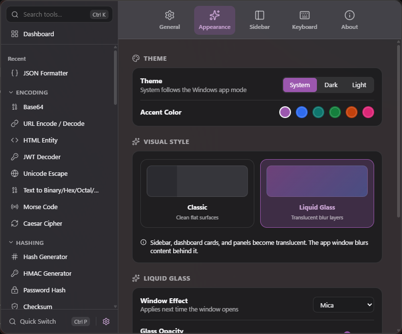
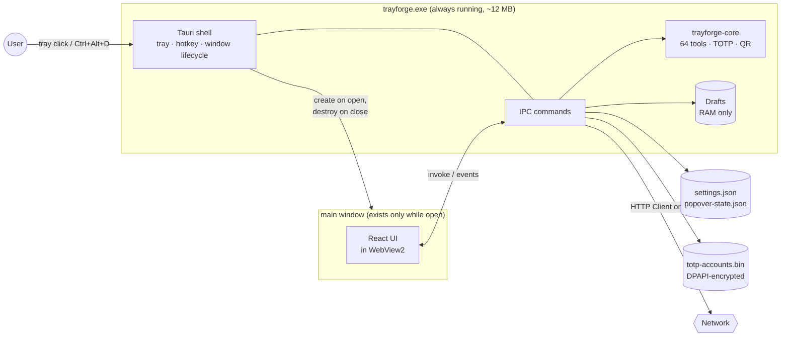
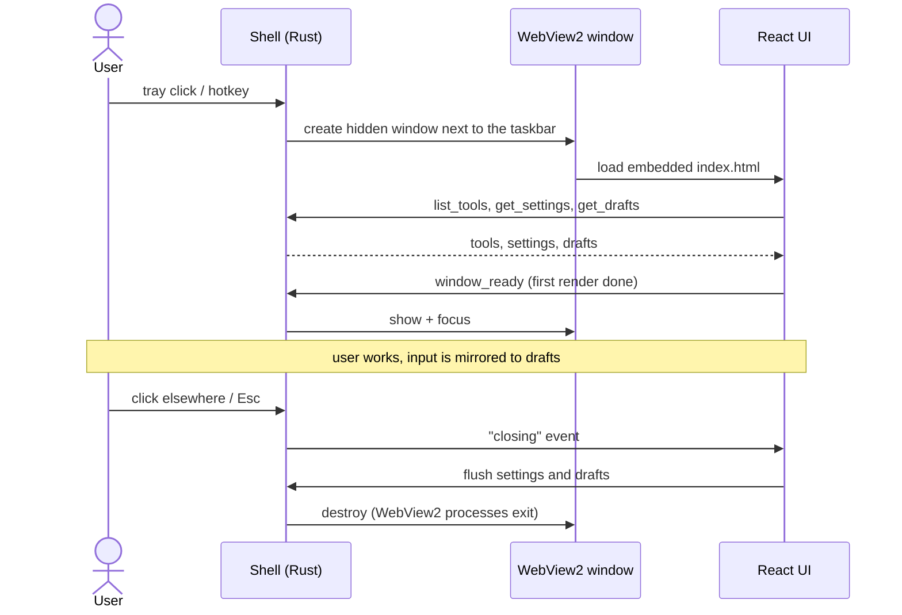

<div align="center">


# Trayforge

### 64 developer tools in your Windows tray: offline, instant, private.

[](https://www.rust-lang.org/)
[](https://tauri.app/)
[](https://react.dev/)
[](https://www.typescriptlang.org/)
[](https://github.com/hhhhhffd/trayforge/releases)

[](https://github.com/hhhhhffd/trayforge/actions/workflows/ci.yml)
[](https://github.com/hhhhhffd/trayforge/releases/latest)
[](https://github.com/hhhhhffd/trayforge/releases)
[](LICENSE)

[**Download**](https://github.com/hhhhhffd/trayforge/releases/latest) ·
[**Website**](https://hhhhhffd.github.io/trayforge/) ·
[**Architecture**](docs/ARCHITECTURE.md) ·
[**Build**](docs/BUILD.md)

</div>

---

## Overview

Developers keep opening random websites to decode a JWT, format JSON or generate a UUID:
slow, distracting, and they send your data to someone else's server. Trayforge puts those tools
one hotkey away. Press `Ctrl+Alt+D`, paste something, get it encoded, hashed, formatted or
converted, and get back to work.

The engineering goal is a tray app that costs almost nothing while you are not using it.
All tools run in a native Rust core, and the WebView2 UI exists only while its window is
open. Idle, Trayforge is a single ~12 MB process with no window, no WebView and no timers.

## Highlights

- **64 tools** in 7 categories: encoders, hashes, formatters, converters, generators, a regex
  tester, an HTTP client, a TOTP generator, a screen color picker and more.
- **Tiny when idle.** About 12 MB of RAM in the tray. The window is created on demand and
  destroyed on close, so WebView2 exits with it.
- **Instant and offline.** Every tool runs locally in Rust. No server, no round trips.
- **Remembers what you were doing.** Close the window mid-task and reopen it: the same tool
  and the same input are back. This memory lives in RAM only and is gone when you quit.
- **TOTP for 2FA testing.** Keep several accounts with live codes side by side. Import them
  from a QR screenshot. Secrets are encrypted with Windows DPAPI.
- **Tray popover or standalone window.** The popover opens next to the taskbar, remembers
  its size, can be dragged, and steps aside for an auto-hidden taskbar.
- **Keyboard first.** Global hotkey, quick switcher, search and a shortcut for every action.
- **Private.** No telemetry, no accounts. Only the HTTP Client touches the network, and only
  with the requests you write.

## Screenshots

<table>
  <tr>
    <td align="center"><br><sub><b>Dashboard</b></sub></td>
    <td align="center"><br><sub><b>A tool: JSON Formatter</b></sub></td>
  </tr>
  <tr>
    <td align="center" colspan="2"><br><sub><b>Settings</b></sub></td>
  </tr>
</table>

## Install

### winget

```powershell
winget install hhhhhffd.Trayforge
```

> The winget package is in review in [microsoft/winget-pkgs](https://github.com/microsoft/winget-pkgs/pulls?q=is%3Apr+hhhhhffd.Trayforge).
> Until it is merged, use a download below.

### Download

Get the latest build from [Releases](https://github.com/hhhhhffd/trayforge/releases/latest):

| File | What it is |
| --- | --- |
| `Trayforge_<version>_x64-setup.exe` | Per-user installer (NSIS), no administrator rights needed |
| `Trayforge_<version>_x64_en-US.msi` | MSI package for managed deployments |
| `Trayforge_<version>_x64_portable.exe` | Single executable, no install |
| `SHA256SUMS.txt` | Checksums to verify the downloads |

Requires Windows 10 or 11 (x64) with the WebView2 runtime, which ships with Windows 11 and
current Windows 10.

Builds are not code-signed yet, so SmartScreen may show "Windows protected your PC". Click
**More info**, then **Run anyway**.

## Technical stack

| Layer | Technologies |
| --- | --- |
| **Core** | Rust: `trayforge-core` holds all 64 tools behind one contract, plus TOTP (RFC 6238) and QR decoding. It has no UI or OS dependencies. |
| **Shell** | Tauri 2: tray icon, global hotkey, single instance, on-demand window, IPC commands, HTTP client (`reqwest` + rustls). |
| **UI** | React 18, TypeScript, Vite, lucide icons, rendered in WebView2. |
| **Platform** | Win32 through `windows-rs`: taskbar geometry, foreground tracking, DPAPI encryption, screen color picker. |
| **Delivery** | GitHub Actions CI, NSIS and WiX installers, GitHub Pages site, winget. |

## Architecture

### System overview



### Window lifecycle

The window is the expensive part (WebView2 is a multi-process browser), so it never outlives
its use. It is also kept hidden until the UI has rendered, so it never shows as an empty frame.



### Running a tool

`process_tool` runs the tool from the core crate on a blocking thread, so a heavy input never
freezes the shell's event loop. Results come back as typed JSON: text with metadata, or a list
of labeled items. Errors come back as `{ kind, message, display }`. The full IPC contract is in
[docs/ARCHITECTURE.md](docs/ARCHITECTURE.md).

### Where state lives

| State | Storage | Lifetime |
| --- | --- | --- |
| Preferences, favorites, recent tools | `settings.json` in the app config folder | Permanent |
| Popover size | `popover-state.json` | Permanent, until reset in Settings |
| Saved TOTP accounts | `totp-accounts.bin`, encrypted with DPAPI for the current Windows user | Permanent |
| Open view and unsaved input | Shell memory (drafts) | Until the app quits |

### Architecture decisions

- **Tauri + WebView2 instead of Electron.** WebView2 already ships with Windows, so the
  installer is about 3 MB and no Chromium copy is bundled. Tools are written in Rust, not in
  JavaScript.
- **The window is destroyed, not hidden, on close.** A hidden WebView2 window keeps
  ~150-350 MB alive. Destroying it keeps the idle app at ~12 MB, at the cost of about a third
  of a second to open. The open path is tuned for that: the window waits hidden for the first
  render, and the UI loads only the icons it uses.
- **A separate pure-Rust core crate.** All tool logic sits in `trayforge-core` with no Tauri
  or Windows dependency. It is tested on Linux in CI, and the shell only adapts it to IPC.
- **Secrets encrypted, drafts never written.** TOTP secrets you save are sealed with DPAPI,
  so the file is useless on another account or machine. Unsaved input, which can contain
  tokens and secrets too, stays in process memory and is never written to disk.

### Project layout

```text
trayforge/
├── crates/trayforge-core/   # Pure Rust: tool contract, 58 standard tools, TOTP, QR
│   ├── src/tools/           #   one module per category
│   └── tests/               #   behavior and hardening tests
├── src-tauri/               # Tauri 2 shell (Windows)
│   └── src/
│       ├── main.rs          #   tray, menu, hotkey, single instance, command registry
│       ├── window.rs        #   on-demand popover/standalone window, focus, placement
│       ├── commands.rs      #   IPC commands, drafts, HTTP client
│       ├── totp_store.rs    #   DPAPI-encrypted TOTP accounts
│       ├── taskbar.rs       #   taskbar edge and auto-hide detection
│       └── picker.rs        #   screen color picker
├── ui/src/                  # React UI: shell, standard tool view, custom panels
├── site/                    # GitHub Pages website
├── docs/                    # Architecture, build and design notes
└── .github/workflows/       # CI and Pages
```

## Build from source

Requirements: Windows 10/11 with Rust (`stable-x86_64-pc-windows-msvc`), Visual Studio 2022
Build Tools, Node.js with pnpm, and the WebView2 runtime. The core crate builds and tests on
any OS.

```powershell
pnpm --dir ui install
pnpm --dir ui run build              # ui/dist, embedded into the exe
cargo build --release -p trayforge   # target\release\trayforge.exe
```

| Task | Command |
| --- | --- |
| Installers (NSIS + MSI) | `cargo tauri build` (needs `cargo install tauri-cli`) |
| Development with hot reload | `cargo tauri dev` |
| Core tests (any OS) | `cargo test -p trayforge-core` |
| Lint | `cargo clippy -p trayforge --no-deps -- -D warnings` |
| UI typecheck | `pnpm --dir ui run lint` |
| Memory of the process tree | `scripts/measure-memory.ps1 -Exe target\release\trayforge.exe` |

The UI also runs in a plain browser (`pnpm --dir ui run dev`) against a mock of the shell. To
fill its tool list, run `cargo run -p trayforge-core --example dump_tools > ui/public/dev-tools.json`.

CI runs on every push and pull request: rustfmt, clippy and tests for the core on Linux, a
typecheck and build of the UI, and clippy for the Windows shell. See [docs/BUILD.md](docs/BUILD.md)
for details.

No environment variables, accounts or API keys are needed to build or run Trayforge.

## Tools

<details>
<summary><b>Encoding (8)</b></summary>

Base64, URL Encode / Decode, HTML Entity, JWT Decoder, Unicode Escape, Text to Binary/Hex/Octal/Decimal, Morse Code, Caesar Cipher
</details>

<details>
<summary><b>Hashing (8)</b></summary>

Hash Generator, HMAC Generator, Password Hash, Checksum, UUID Generator, ULID Generator, Random String, Nanoid
</details>

<details>
<summary><b>Formats (11)</b></summary>

JSON Formatter, JSON Path Query, JSON ↔ YAML, YAML Formatter, XML Formatter, XML ↔ JSON, CSV → JSON, JSON → CSV, SQL Formatter, GraphQL Formatter, TOML Parser
</details>

<details>
<summary><b>Web Dev (9)</b></summary>

Color Converter, CSS Minifier, JS Minifier, HTML Minifier, Markdown Preview, Lorem Ipsum, Data URI, SVG Path Analyzer, Placeholder Image
</details>

<details>
<summary><b>Text (12)</b></summary>

String Case, Regex Tester, Regex Library, String Diff, Line Sorter, Text Statistics, String Escape, Whitespace Tool, Base Converter, Unix Timestamp, Epoch Batch Converter, Slug Generator
</details>

<details>
<summary><b>Dev Utils (12)</b></summary>

QR Code, Cron Parser, Git Branch Name, Semver Comparator, ASCII Art, HTTP Status, MIME Type, Port Lookup, IP Address, Certificate Decoder, HTTP Client, TOTP Generator
</details>

<details>
<summary><b>Graphics (4)</b></summary>

Tailwind Colors, Color Palettes, SVG Editor, Screen Color Picker
</details>

Behavior choices, option lists and safety limits are documented in
[docs/DESIGN_NOTES.md](docs/DESIGN_NOTES.md).

## Keyboard shortcuts

| Action | Shortcut |
| --- | --- |
| Toggle Trayforge (global, rebindable) | `Ctrl+Alt+D` |
| Search tools | `Ctrl+K` |
| Quick Switch | `Ctrl+P` |
| Process | `Ctrl+Enter` |
| Copy output | `Ctrl+Shift+C` |
| Clear all | `Ctrl+L` |
| Swap input/output | `Ctrl+Shift+S` |
| Toggle favorite | `Ctrl+B` |
| Screen color picker | `Ctrl+Shift+P` |
| Category 1-7 | `Ctrl+1` ... `Ctrl+7` |
| Settings | `Ctrl+,` |
| Close window | `Esc` |

## Privacy

Trayforge has no telemetry, no analytics and no update pings. The only tool that touches the
network is the HTTP Client, and it sends only the requests you write. Settings and saved TOTP
accounts are stored locally in your user profile; saved TOTP secrets are encrypted with DPAPI.

## License

[MIT](LICENSE) © 2026 hhhhhffd
