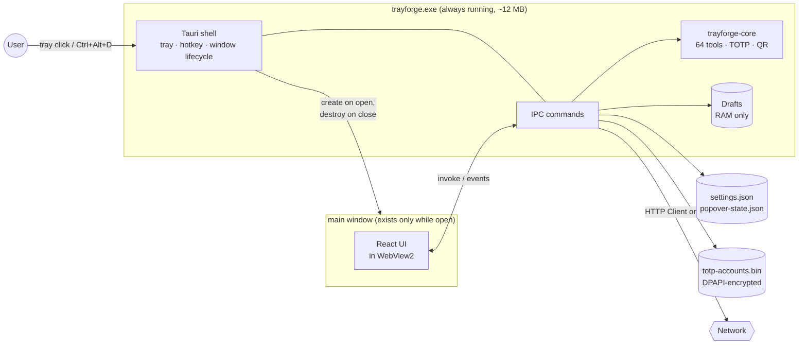
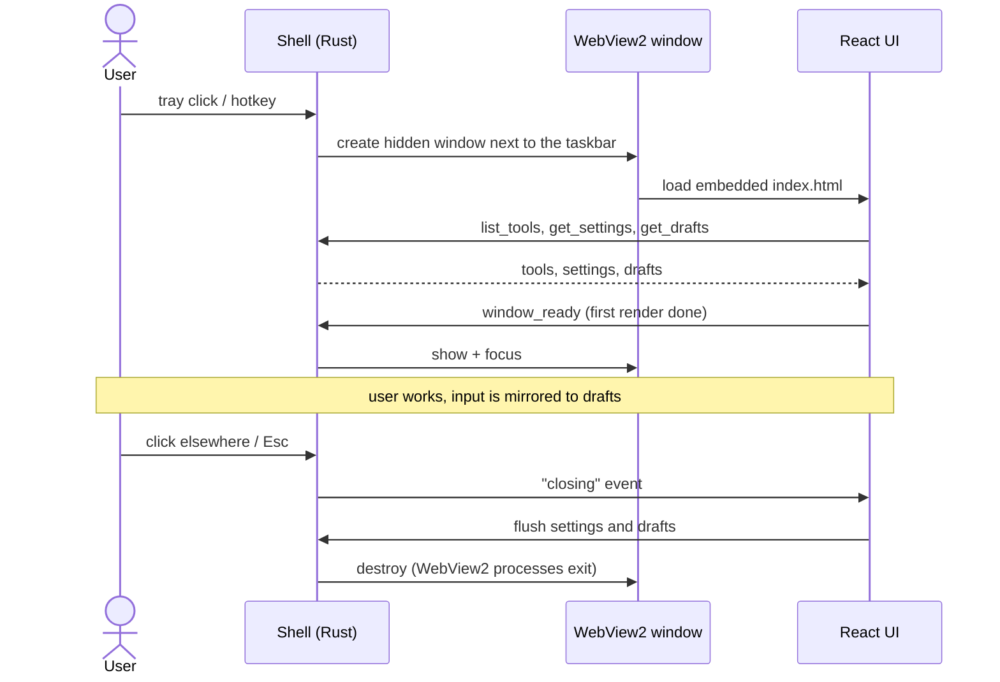

<div align="center">


# Trayforge

### 64 инструмента разработчика в трее Windows: офлайн, мгновенно, приватно.

[](https://www.rust-lang.org/)
[](https://tauri.app/)
[](https://react.dev/)
[](https://www.typescriptlang.org/)
[](https://github.com/hhhhhffd/trayforge/releases)

[](https://github.com/hhhhhffd/trayforge/actions/workflows/ci.yml)
[](https://github.com/hhhhhffd/trayforge/releases/latest)
[](https://github.com/hhhhhffd/trayforge/releases)
[](LICENSE)

[English](README.md) · **Русский**

[**Скачать**](https://github.com/hhhhhffd/trayforge/releases/latest) ·
[**Сайт**](https://hhhhhffd.github.io/trayforge/) ·
[**Архитектура**](docs/ARCHITECTURE.md) ·
[**Сборка**](docs/BUILD.md)

</div>

---

## Обзор

Разработчики постоянно открывают случайные сайты, чтобы разобрать JWT, отформатировать JSON или
сгенерировать UUID: это медленно, отвлекает и отправляет ваши данные на чужой сервер. Trayforge
держит эти инструменты под рукой. Нажмите `Ctrl+Alt+D`, вставьте текст и получите его
закодированным, захешированным, отформатированным или преобразованным.

Инженерная цель: трей-приложение, которое почти ничего не стоит, пока им не пользуются. Все
инструменты работают в нативном Rust-ядре, а UI на WebView2 существует, только пока открыто окно.
В простое Trayforge это один процесс около 12 МБ без окна, без WebView и без таймеров.

## Основное

- **Выпущен.** v1.0.0 опубликован в Microsoft Store как пакет MSIX; установщики NSIS и MSI лежат в GitHub Releases.
- **64 инструмента** в 7 категориях: кодировщики, хеши, форматтеры, конвертеры, генераторы,
  тестер regex, HTTP-клиент, генератор TOTP, пипетка цвета с экрана и другое.
- **Лёгкий в простое.** Около 12 МБ RAM в трее. Окно создаётся по требованию и уничтожается
  при закрытии, поэтому WebView2 завершается вместе с ним.
- **Мгновенно и офлайн.** Каждый инструмент выполняется локально в Rust, без сервера.
- **Помнит, чем вы занимались.** Закройте окно посреди задачи и откройте снова: тот же инструмент
  и тот же ввод на месте. Эта память хранится только в RAM и исчезает при выходе.
- **TOTP для тестирования 2FA.** Несколько аккаунтов с живыми кодами рядом, импорт из скриншота QR.
  TOTP реализован по RFC 6238, секреты шифруются Windows DPAPI.
- **Всплывающее окно у трея или обычное окно.** Окно открывается у панели задач, запоминает размер,
  перетаскивается и уступает место автоскрываемой панели задач.
- **Клавиатура прежде всего.** Глобальная горячая клавиша, быстрое переключение, поиск и шорткат на каждое действие.
- **Протестирован.** 188 тестов покрывают ядро, включая лимиты против враждебного ввода (глубина
  вложенности, число совпадений, ограничения размера). CI запускает rustfmt, clippy с `-D warnings` и `cargo test`.
- **Приватно.** Без телеметрии и аккаунтов. В сеть ходит только HTTP-клиент и только с вашими запросами.

## Скриншоты

<table>
  <tr>
    <td align="center"><br><sub><b>Dashboard</b></sub></td>
    <td align="center"><br><sub><b>Инструмент: JSON Formatter</b></sub></td>
  </tr>
  <tr>
    <td align="center" colspan="2"><br><sub><b>Settings</b></sub></td>
  </tr>
</table>

## Установка

### Microsoft Store

Trayforge 1.0.0 опубликован в Microsoft Store как пакет MSIX. [Установить из Microsoft Store](https://apps.microsoft.com/detail/9P8SSQ8SZ9N0).

### winget

```powershell
winget install hhhhhffd.Trayforge
```

> Пакет winget находится на рассмотрении в [microsoft/winget-pkgs](https://github.com/microsoft/winget-pkgs/pulls?q=is%3Apr+hhhhhffd.Trayforge).
> До слияния используйте загрузку ниже.

### Загрузка

Последняя сборка: [Releases](https://github.com/hhhhhffd/trayforge/releases/latest).

| Файл | Что это |
| --- | --- |
| `Trayforge_<version>_x64-setup.exe` | Установщик для пользователя (NSIS), права администратора не нужны |
| `Trayforge_<version>_x64_en-US.msi` | MSI-пакет для управляемого развёртывания |
| `Trayforge_<version>_x64_portable.exe` | Один исполняемый файл, без установки |
| `SHA256SUMS.txt` | Контрольные суммы для проверки загрузок |

Нужна Windows 10 или 11 (x64) с WebView2 runtime; он входит в Windows 11 и актуальную Windows 10.

Сборки пока не подписаны кодом, поэтому SmartScreen может показать "Windows protected your PC".
Нажмите **More info**, затем **Run anyway**.

## Технологический стек

| Слой | Технологии |
| --- | --- |
| **Ядро** | Rust: `trayforge-core` содержит все 64 инструмента за одним контрактом, а также TOTP (RFC 6238) и декодирование QR. Без зависимостей от UI и ОС. |
| **Оболочка** | Tauri 2: иконка в трее, глобальный хоткей, один экземпляр, окно по требованию, IPC-команды, HTTP-клиент (`reqwest` + rustls). |
| **UI** | React 18, TypeScript, Vite, иконки lucide, рендер в WebView2. |
| **Платформа** | Win32 через `windows-rs`: геометрия панели задач, отслеживание foreground, шифрование DPAPI, пипетка цвета. |
| **Поставка** | GitHub Actions CI, MSIX (Microsoft Store), установщики NSIS и WiX, сайт на GitHub Pages, winget. |

## Архитектура

### Общая схема



### Жизненный цикл окна

Окно самая дорогая часть (WebView2 это многопроцессный браузер), поэтому оно не живёт дольше
необходимого. Оно скрыто, пока UI не отрисован, поэтому никогда не показывается пустым кадром.



### Запуск инструмента

`process_tool` выполняет инструмент из core-крейта в блокирующем потоке, поэтому тяжёлый ввод не
замораживает цикл событий оболочки. Результат возвращается типизированным JSON: текст с метаданными
или список именованных элементов. Ошибки приходят как `{ kind, message, display }`. Полный IPC-контракт описан в
[docs/ARCHITECTURE.md](docs/ARCHITECTURE.md).

### Где хранится состояние

| Состояние | Хранилище | Время жизни |
| --- | --- | --- |
| Настройки, избранное, недавние инструменты | `settings.json` в папке конфигурации | Постоянно |
| Размер всплывающего окна | `popover-state.json` | Постоянно, до сброса в настройках |
| Сохранённые TOTP-аккаунты | `totp-accounts.bin`, шифрование DPAPI для текущего пользователя Windows | Постоянно |
| Открытый вид и несохранённый ввод | Память оболочки (drafts) | До выхода из приложения |

### Архитектурные решения

- **Tauri + WebView2 вместо Electron.** WebView2 уже есть в Windows, поэтому установщик около 3 МБ
  и Chromium не поставляется. Инструменты написаны на Rust, а не на JavaScript.
- **Окно уничтожается, а не скрывается.** Скрытое окно WebView2 держит ~150-350 МБ. Уничтожение
  оставляет простаивающее приложение на ~12 МБ ценой примерно трети секунды на открытие. Путь открытия
  оптимизирован: окно ждёт скрытым первой отрисовки, UI загружает только используемые иконки.
- **Отдельный чисто-Rust core-крейт.** Вся логика инструментов в `trayforge-core` без зависимостей
  от Tauri и Windows. Он тестируется на Linux в CI, оболочка лишь адаптирует его к IPC.
- **Секреты шифруются, черновики не пишутся на диск.** Сохранённые TOTP-секреты запечатаны DPAPI,
  файл бесполезен на другой учётной записи или машине. Несохранённый ввод остаётся в памяти процесса.

### Структура проекта

```text
trayforge/
├── crates/trayforge-core/   # Чистый Rust: контракт инструментов, 58 стандартных инструментов, TOTP, QR
│   ├── src/tools/           #   модуль на категорию
│   └── tests/               #   тесты поведения и устойчивости
├── src-tauri/               # Оболочка Tauri 2 (Windows)
│   └── src/
│       ├── main.rs          #   трей, меню, хоткей, один экземпляр, реестр команд
│       ├── window.rs        #   окно по требованию, фокус, позиционирование
│       ├── commands.rs      #   IPC-команды, drafts, HTTP-клиент
│       ├── totp_store.rs    #   TOTP-аккаунты с шифрованием DPAPI
│       ├── taskbar.rs       #   край панели задач и автоскрытие
│       └── picker.rs        #   пипетка цвета
├── ui/src/                  # React UI: оболочка, стандартный вид инструмента, кастомные панели
├── site/                    # Сайт на GitHub Pages
├── docs/                    # Архитектура, сборка, заметки о дизайне
└── .github/workflows/       # CI и Pages
```

## Сборка из исходников

Требования: Windows 10/11, Rust (`stable-x86_64-pc-windows-msvc`), Visual Studio 2022 Build Tools,
Node.js с pnpm и WebView2 runtime. Core-крейт собирается и тестируется на любой ОС.

```powershell
pnpm --dir ui install
pnpm --dir ui run build              # ui/dist, встраивается в exe
cargo build --release -p trayforge   # target\release\trayforge.exe
```

| Задача | Команда |
| --- | --- |
| Установщики (NSIS + MSI) | `cargo tauri build` (нужен `cargo install tauri-cli`) |
| Разработка с hot reload | `cargo tauri dev` |
| Тесты ядра (любая ОС) | `cargo test -p trayforge-core` |
| Линтер | `cargo clippy -p trayforge --no-deps -- -D warnings` |
| Проверка типов UI | `pnpm --dir ui run lint` |
| Память дерева процессов | `scripts/measure-memory.ps1 -Exe target\release\trayforge.exe` |

UI также запускается в обычном браузере (`pnpm --dir ui run dev`) с моком оболочки. Чтобы заполнить
список инструментов: `cargo run -p trayforge-core --example dump_tools > ui/public/dev-tools.json`.

CI запускается на каждый push и pull request: rustfmt, clippy и тесты ядра на Linux, проверка типов и
сборка UI, clippy для Windows-оболочки. Подробности в [docs/BUILD.md](docs/BUILD.md).

Для сборки и запуска не нужны переменные окружения, аккаунты и API-ключи.

## Инструменты

<details>
<summary><b>Кодирование (8)</b></summary>

Base64, URL Encode / Decode, HTML Entity, JWT Decoder, Unicode Escape, Text to Binary/Hex/Octal/Decimal, Morse Code, Caesar Cipher
</details>

<details>
<summary><b>Хеши (8)</b></summary>

Hash Generator, HMAC Generator, Password Hash, Checksum, UUID Generator, ULID Generator, Random String, Nanoid
</details>

<details>
<summary><b>Форматы (11)</b></summary>

JSON Formatter, JSON Path Query, JSON ↔ YAML, YAML Formatter, XML Formatter, XML ↔ JSON, CSV → JSON, JSON → CSV, SQL Formatter, GraphQL Formatter, TOML Parser
</details>

<details>
<summary><b>Веб (9)</b></summary>

Color Converter, CSS Minifier, JS Minifier, HTML Minifier, Markdown Preview, Lorem Ipsum, Data URI, SVG Path Analyzer, Placeholder Image
</details>

<details>
<summary><b>Текст (12)</b></summary>

String Case, Regex Tester, Regex Library, String Diff, Line Sorter, Text Statistics, String Escape, Whitespace Tool, Base Converter, Unix Timestamp, Epoch Batch Converter, Slug Generator
</details>

<details>
<summary><b>Утилиты (12)</b></summary>

QR Code, Cron Parser, Git Branch Name, Semver Comparator, ASCII Art, HTTP Status, MIME Type, Port Lookup, IP Address, Certificate Decoder, HTTP Client, TOTP Generator
</details>

<details>
<summary><b>Графика (4)</b></summary>

Tailwind Colors, Color Palettes, SVG Editor, Screen Color Picker
</details>

Выбор поведения, списки опций и лимиты безопасности описаны в
[docs/DESIGN_NOTES.md](docs/DESIGN_NOTES.md).

## Горячие клавиши

| Действие | Сочетание |
| --- | --- |
| Показать/скрыть Trayforge (глобально, настраивается) | `Ctrl+Alt+D` |
| Поиск инструментов | `Ctrl+K` |
| Quick Switch | `Ctrl+P` |
| Выполнить | `Ctrl+Enter` |
| Копировать вывод | `Ctrl+Shift+C` |
| Очистить всё | `Ctrl+L` |
| Поменять ввод и вывод | `Ctrl+Shift+S` |
| Избранное | `Ctrl+B` |
| Пипетка цвета | `Ctrl+Shift+P` |
| Категория 1-7 | `Ctrl+1` ... `Ctrl+7` |
| Настройки | `Ctrl+,` |
| Закрыть окно | `Esc` |

## Приватность

В Trayforge нет телеметрии, аналитики и проверок обновлений. В сеть ходит только HTTP-клиент, и только с
вашими запросами. Настройки и сохранённые TOTP-аккаунты хранятся локально в профиле пользователя;
TOTP-секреты шифруются DPAPI.

## Лицензия

[MIT](LICENSE) © 2026 hhhhhffd
